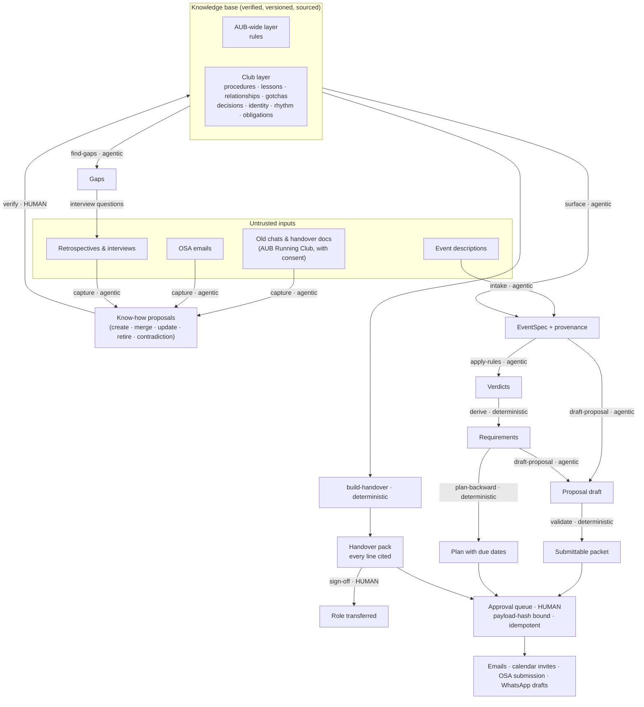

# Architecture

ClubOps keeps a student club's **know-how** alive across cabinet turnover and uses it to prepare the club's event paperwork.
The knowledge base is the spine; the **handover** and the **event packet** are its two consumers.



## Three kinds of component

| Kind | What it does here | Why not the other kinds |
|---|---|---|
| **Agentic** (a model decides) | Reading messy chats and emails, deciding what counts as know-how, merging and spotting contradictions, judging whether a rule applies, phrasing interview questions, ranking what is relevant now | The input is unstructured and the judgement is contextual; rules written by hand would miss most of it |
| **Deterministic** (plain code) | Form validation, requirement derivation, due-date math, gap checks, handover assembly, the approval gate | Same input must give the same output; these are checkable and must never "hallucinate" |
| **Human-controlled** | Verifying know-how, approving every outgoing action, signing off a handover | Wrong know-how or a wrong email to OSA or a sponsor costs the club trust; a person stays accountable |

The full list, with each capability's inputs, outputs, policy and permissions, is generated from code: [capabilities.md](capabilities.md).

## Design rules

1. **Capabilities, not agents, own the contracts** ([ADR 0001](adr/0001-capabilities-not-agents.md)). A single agent and a multi-agent setup call the same typed functions, so they can be compared fairly.
2. **Nothing enters the knowledge base without a cabinet member** ([ADR 0002](adr/0002-verified-writes.md)). The model proposes; a person verifies.
3. **Untrusted content is data.** Chats, emails and interview answers arrive as `Untrusted` and only `capture` and `intake` accept them. They can produce proposals, never actions.
4. **Every side effect goes through the approval gate** ([ADR 0005](adr/0005-approval-gate.md)). An approval is bound to the exact payload; an edit voids it.
5. **Every fact carries its source.** Know-how cites the messages it came from; answers cite know-how or say "not known"; handover lines cite items or open gaps.
6. **Contracts are code** ([ADR 0003](adr/0003-pydantic-source-of-truth.md)). Pydantic models are the source of truth; JSON Schemas and docs are generated and CI fails on drift.

## Trust boundaries

```
 outside world (chats, email, sponsors)  ──Untrusted──▶  capture / intake  ──proposals──▶  [human verify]  ──▶  knowledge base
 knowledge base  ──▶  agentic + deterministic capabilities  ──ProposedAction──▶  [human approve]  ──▶  outside world
```

The model never holds credentials and never sends anything itself. See [threat-model.md](threat-model.md).

## Where things live

| Path | Contents |
|---|---|
| `src/clubops/contracts/` | All input/output models (the contracts) |
| `src/clubops/capabilities/` | Registry, runner (policy, auth, tracing), deterministic capabilities |
| `src/clubops/knowhow/` | Knowledge store, gap checks, handover assembly |
| `data/forms/` | OSA forms as versioned data |
| `schemas/` | Generated JSON Schemas |
| `eval/` | Evaluation datasets and protocol |
| `docs/` | This documentation |
