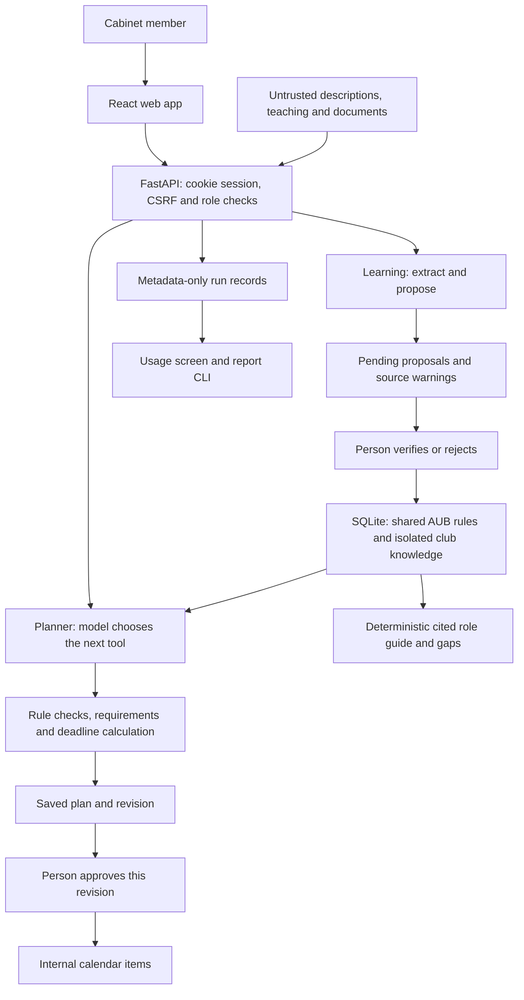

# Architecture

Updated 1 November 2026 from the published contracts, plan and API table. Local integration and container checks are recorded in `web/VERIFICATION.md`; public deployment and live provider measurements remain pending.

## Request and approval flow

The planner can choose its own steps inside a user-started run. It cannot approve its own plan, verify knowledge or send a message. An edited event requires review of the new revision. Google calendar synchronization, new-club setup, the full chatbot and draft-generation wiring have separate owners/tasks; consult [api.md](api.md) for the current endpoint status rather than assuming a diagram is deployed functionality.

## What makes decisions

| Component | Decision and boundary | Public interface/evidence |
|---|---|---|
| Planner | Model chooses tools and asks questions; code checks valid transitions and enforces each explicit allowance of 8 steps / $0.05 | `AgentRun`, event contracts, API run endpoints, `tests/test_api.py` |
| Rule check | Plain code evaluates explicit facts; a bounded model call handles description-dependent conditions. Missing/failed evidence stays uncertain | Rule/verdict contracts, `docs/plan.md`, `tests/test_rules_check.py` |
| Learning | Model proposes from redacted input; code validates quoted support and candidate shape. Expense spreadsheets have a deterministic price-list path | Capture/know-how contracts, `tests/test_learning.py` |
| Memory approval | A person verifies, rejects or edits proposals. Warnings and outdated sources require individual frontend review rather than batch approval | Verify contracts, Review API, `web/e2e/contracts.spec.ts` |
| Plan approval | Server checks the submitted revision before creating internal calendar items | Event/API contracts, `web/e2e/live-api.spec.ts` |
| Handover | Existing plain-code assembly becomes a view retaining current sources and explicit gaps; no model call | Handover contracts, `tests/test_handover_view.py`, `tests/test_handover_endpoint.py` |
| Reporting | Deduplicates cumulative snapshots and trace IDs; absent metrics are unavailable, not zero | `src/clubops/reports/`, report tests |

Draft text is for a person to inspect and copy/send. Handover sign-off and several editing actions remain demo-only; the real transport reports unavailable actions explicitly.

## Hosting and authentication

Production packaging uses one origin: Caddy serves the static React build and proxies `/api` to one API worker. SQLite databases and metadata live under `CLUBOPS_DATA_DIR` on the persistent volume. The default production image requires a Google client ID, a server session secret, secure cookies and dev sign-in disabled. Google credentials are exchanged for an HttpOnly session; the browser does not store the token. Club and permissions come from the server session, never the selected UI club or a caller-supplied URL.

The separate Compose `local` target compiles an explicit dev sign-in form, boots a synthetic cabinet account, and publishes only a loopback port. It generates a local signing secret on the named volume so sessions survive container replacement. The default production target rejects a frontend built with local login. One-command setup and its remaining provider/hosting requirements are in the [README](../README.md) and [deployment guide](../web/DEPLOYMENT.md).

## Data and credential boundaries

1. External text is `Untrusted` data. Hidden instructions do not gain system authority; learning proposals remain subject to human review.
2. Shared AUB rules and per-club knowledge use separate SQLite scopes. Cross-club IDs return 404. Frontend visibility is not authorization.
3. Contract definitions own field names and versions. Generated schemas must match them in CI; HTTP screen adapters do not redefine Python contracts.
4. Provider credentials stay on the server. Build inputs exclude private/runtime files; the optional local trust bundle is a temporary BuildKit secret and is not copied into the image.
5. Reporting stores counts, timing, model/prompt versions and cost metadata, never prompts, source text or personal labels. Producers must identify the club before using the scoped trace sink.
6. Retention, consent and deletion limits are explicit in [data-provenance.md](data-provenance.md) and [knowledge-base.md](knowledge-base.md). A named volume preserves data but does not prove that backups or deletion jobs exist.

## Current operations and limits

- Python CI checks lint, strict types, coverage and schema drift; dependency auditing remains active.
- PR #44 adds frontend quality/browser gates and container/persistence checks. A teammate review and green main run are still required before claiming the new gates are established on main.
- OpenTelemetry export, deployed monitoring/alerts and final evaluation thresholds remain C-25/C-26/C-22 work. Metadata fields alone do not prove those systems are running.
- Runs execute in-process; a single worker/instance is the supported deployment configuration. Finish active planning before a restart. Durable job recovery and horizontal scaling are not claimed.
- Real provider quality, production OAuth, persistent hosting recovery and real-world pilot outcomes are not established by scripted tests.
