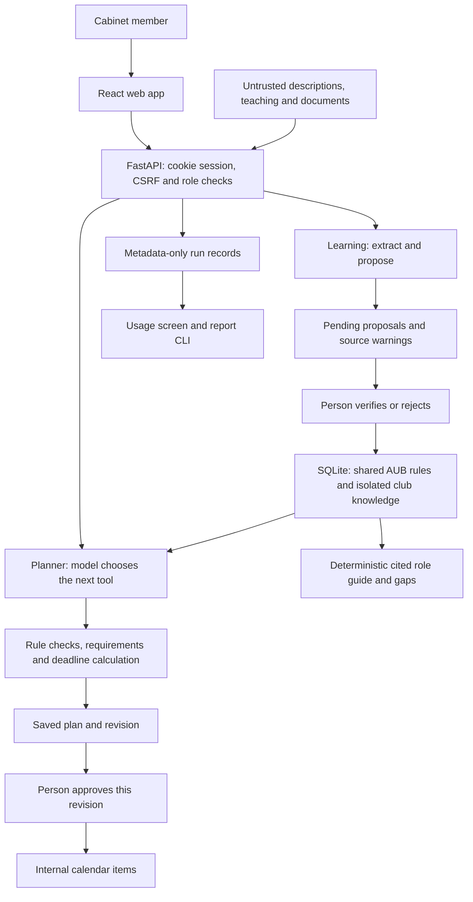

# Architecture

Updated 16 November 2026 against main `54d38c1`, published interfaces and merged integration PRs. Local integration and container checks are recorded in `web/VERIFICATION.md`; provider/evaluation evidence belongs in `results/` and `docs/evidence.md`. Public deployment remains pending. Report sections and their evidence limits are in [architecture-and-operations.md](../web/report/architecture-and-operations.md).

## Request and approval flow

The planner can choose its own steps inside a user-started run. It cannot approve its own plan, verify knowledge or send a message. An edited event requires review of the new revision. New-club setup is registered in the application through merged [#87](https://github.com/Nohra2005/ClubOps/pull/87). Google calendar synchronization, the full chatbot and draft-generation wiring have separate owners/tasks. The [API table](api.md) remains the interface reference, but its setup 501 and always-complete notes predate #87; the setup status below supersedes those notes, without changing the contract.

## What makes decisions

| Component | Decision and boundary | Public interface/evidence |
|---|---|---|
| Planner | Model chooses tools and asks questions; code checks valid transitions and enforces each explicit allowance of 8 steps / $0.05 | `AgentRun`, event contracts, API run endpoints, `tests/test_api.py` |
| Rule check | Plain code evaluates explicit facts; a bounded model call handles description-dependent conditions. Missing/failed evidence stays uncertain | Rule/verdict contracts, `docs/plan.md`, `tests/test_rulebook.py` |
| Learning | Model proposes from redacted input; code validates quoted support and candidate shape, drops one-time facts and personal opinions, and expires this-term facts. Expense spreadsheets have a deterministic price-list path | Capture/know-how contracts, D-95, `tests/test_learning.py` |
| Memory approval | A person verifies, rejects or edits proposals. Warnings and outdated sources require individual frontend review rather than batch approval | Verify contracts, Review API, `web/e2e/contracts.spec.ts` |
| Plan approval | Server checks the submitted revision before creating internal calendar items | Event/API contracts, `web/e2e/live-api.spec.ts` |
| Handover | Existing plain-code assembly becomes a view retaining current sources and explicit gaps; no model call | Handover contracts, `tests/test_handover_view.py`, `tests/test_handover_endpoint.py` |
| Club setup | Explicit president interview; durable question progress; skips/resume avoid extraction, extracted facts wait in Review | `POST /api/setup/next`, `web/CLUB_SETUP.md`, `web/e2e/setup-live.spec.ts` |
| Reporting | Deduplicates cumulative snapshots and trace IDs; absent metrics are unavailable, not zero | `src/clubops/reports/`, report tests |

Draft text is for a person to inspect and copy/send. Handover sign-off and several editing actions remain demo-only; the real transport reports unavailable actions explicitly.

## Hosting and authentication

Production packaging uses one origin: Caddy serves the static React build and proxies `/api` to one API worker. SQLite databases and metadata live under `CLUBOPS_DATA_DIR` on the persistent volume. The default production image requires a Google client ID, a server session secret, secure cookies and dev sign-in disabled. Google credentials are exchanged for an HttpOnly session; the browser does not store the token. Club and permissions come from the server session, never the selected UI club or a caller-supplied URL.

The separate Compose `local` target compiles an explicit dev sign-in form, boots a synthetic cabinet account, and publishes only a loopback port. It generates a local signing secret on the named volume so sessions survive container replacement. The default production target rejects a frontend built with local login. One-command setup and its remaining provider/hosting requirements are in the [README](../README.md) and [deployment guide](../web/DEPLOYMENT.md).

## Data and credential boundaries

1. External text is `Untrusted` data. Hidden instructions do not gain system authority; learning proposals remain subject to human review.
2. Shared AUB rules and per-club knowledge use separate SQLite scopes. Cross-club IDs return 404. Frontend visibility is not authorization.
3. Contract definitions own field names and versions. Generated schemas must match them in CI; HTTP screen adapters do not redefine Python contracts.
4. Provider credentials stay on the server. Build inputs exclude private/runtime files; the optional local trust bundle is a temporary BuildKit secret and is not copied into the image.
5. Reporting stores counts, timing, model/prompt versions and cost metadata, never prompts, source text or personal labels. Producers must identify the club before using the scoped trace sink.
6. Retention, consent and deletion limits are explicit in [data-provenance.md](data-provenance.md) and [knowledge-base.md](knowledge-base.md). A named volume preserves data but does not prove that backups or deletion jobs exist.

## Current operations and limits

- Python CI checks lint, strict types, coverage and schema drift; dependency auditing remains active.
- Python, frontend/browser and container/persistence workflows are established on main after #44/#46. Reproducible commands and dated results are in [`../web/VERIFICATION.md`](../web/VERIFICATION.md); a green workflow establishes checks on its particular revision, not a deployed service or a model-quality result. These checks are separate from evidence of independent teammate review; AGENTS/CONTRIBUTING require that review and merge commits.
- C-25 has an optional closed-run metadata-only OTLP/HTTP JSON exporter and a synthetic local Jaeger proof in [`../web/observability/README.md`](../web/observability/README.md). It requires explicit real run/step/model-call timing and associations; it never infers them from unrelated JSONL records. Producer hooks remain with the agent/model owners, so real-run instrumentation, deployed monitoring/alerts and final evaluation thresholds remain C-25/C-26/C-22 work. The synthetic proof does not establish production operation.
- Runs execute in-process; a single worker/instance is the supported deployment configuration. Finish active planning before a restart. Durable job recovery and horizontal scaling are not claimed.
- Real provider quality, production OAuth, persistent hosting recovery and real-world pilot outcomes are not established by scripted tests.

## Integrated setup service (C-21, PRs #55 and #87)

`src/clubops/api/setup.py` owns durable per-club question progress and an extraction
outbox. It accepts authenticated Actor, capture, idempotent Review submission and
shared-rule count callbacks; it imports contracts rather than backend implementation.
Answers are Untrusted interview sources. Nothing in setup verifies knowledge or
changes cabinet/profile records. The UI supports resume and preserves failed drafts.

PR #55 supplies the service; merged #87 registers it and connects
`/me.club.setup_complete` to its durable progress. The no-interception browser
regression in `web/e2e/setup-live.spec.ts` exercises the actual application factory,
real cookies and SQLite: an empty club is routed to setup, can pause/resume and
complete with skips, and then reports completion. Missing CSRF and adviser writes
are denied. Skips leave Review empty and do not complete the four starter checks.
This checks local HTTP integration, not Google sign-in, worker-restart recovery,
model extraction quality or actual ASME onboarding. Older
`tests/test_setup_endpoint.py` checks still use a reference adapter; do not confuse
that fixture with production registration. The submit callback must preserve earlier
Review decisions on retry; F-201 records the known rejected-proposal retry limit.
See [the integration guide](../web/CLUB_SETUP.md) for the exact boundary and current
answer-only contract's stale-tab limitation, accepted by Tatiana in #43 for one-time,
president-only setup. Reported extraction failures (`sources_failed`) cannot advance
progress or queue partial facts. Sourced ASME seeding remains T-09 work.
