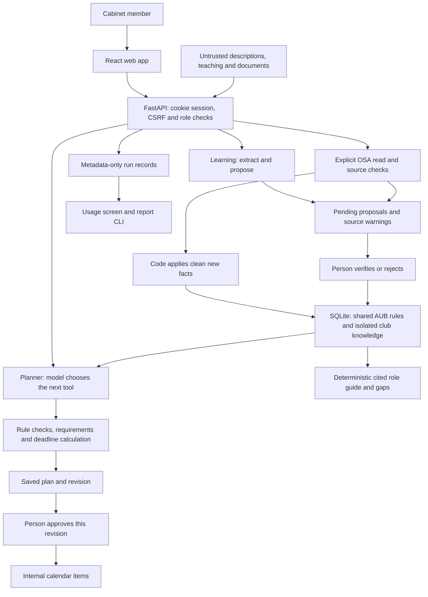

# Architecture

Updated 24 November 2026 against main `eae20c5`, published interfaces and merged integration decisions. Local integration and container checks are recorded in `web/VERIFICATION.md`; provider/evaluation evidence belongs in `results/` and `docs/evidence.md`. Packaging/integration checks do not establish deployed acceptance; that is tracked separately under C-13/C-14/C-18. Report sections and their evidence limits are in [architecture-and-operations.md](../web/report/architecture-and-operations.md).

## Request and approval flow

The planner can choose its own steps inside a user-started run. It cannot approve its own plan or send a message. Knowledge authorization has a separate trusted-mail exception described below; the model itself cannot confer approval. An edited event requires review of the new revision. New-club setup is registered in the application through merged [#87](https://github.com/Nohra2005/ClubOps/pull/87). Google Calendar and draft-generation integration retain separate owner tasks. Cabinet chat is wired to the authenticated club store in #149 (D-200); this is not a completed provider-quality or deployed acceptance claim. The [API table](api.md) remains the interface reference, but its setup 501 and always-complete notes predate #87; the setup status below supersedes those notes, without changing the contract.

## What makes decisions

| Component | Decision and boundary | Public interface/evidence |
|---|---|---|
| Planner | Model chooses tools and asks questions; code checks valid transitions and enforces each explicit allowance of 8 steps / $0.05 | `AgentRun`, event contracts, API run endpoints, `tests/test_api.py` |
| Rule check | Plain code evaluates explicit facts; a bounded model call handles description-dependent conditions. Missing/failed evidence stays uncertain | Rule/verdict contracts, `docs/plan.md`, `tests/test_rulebook.py` |
| Learning | Model proposes from redacted input; code validates quoted support and candidate shape, excludes one-time facts and personal opinions from lasting Knowledge, and expires this-term facts. Dated trusted-mail deadlines have a separate calendar-task path (D-150). Expense spreadsheets have a deterministic price-list path | Capture/know-how contracts, D-95, `tests/test_learning.py` |
| Memory approval | People review interview/chat/document facts and mail overrides/flagged proposals. Only clean new trusted-mail facts can apply by code (D-138 narrowed by D-151); Edit/Undo retain history | Verify contracts, Review API, `web/e2e/contracts.spec.ts` |
| Plan approval | Server checks the submitted revision before creating internal calendar items | Event/API contracts, `web/e2e/live-api.spec.ts` |
| Handover | Existing plain-code assembly becomes a view retaining current sources and explicit gaps; no model call | Handover contracts, `tests/test_handover_view.py`, `tests/test_handover_endpoint.py` |
| Club setup | Explicit president interview; durable question progress; skips/resume avoid extraction, extracted facts wait in Review | `POST /api/setup/next`, `web/CLUB_SETUP.md`, `web/e2e/setup-live.spec.ts` |
| OSA e-mail inbox | Plain code fetches the ClubOps Gmail inbox (free), checks the forwarder against the cabinet list and the original sender against the private OSA list, cleans the text and takes a read-once fingerprint. Only a person's explicit click starts the one paid model read. Whether the cards are AUB-wide or club-only comes from how many people the original went to (10 or more is AUB-wide), not from the model | `src/clubops/inbox/`, `inbox_intake.py`, `/api/inbox` routes, D-113, D-114, D-126, F-214, F-216, F-227, `tests/test_inbox_*.py` |
| Expiry archive | Plain code, no model, treats a fact past its end date as expired: the planner ignores it and the president may restore it with a new date. An AUB-wide fact is operator-only | `KnowHowStore.restore`, `/api/knowledge/{id}/restore`, D-115, D-124, F-215, `tests/test_archive.py` |
| Reporting | Deduplicates cumulative snapshots and trace IDs; absent metrics are unavailable, not zero | `src/clubops/reports/`, report tests |

Draft text is for a person to inspect and copy/send. Handover sign-off and several editing actions remain demo-only; the real transport reports unavailable actions explicitly.

## Model, cost and privacy

- **One model for everything:** Claude Haiku 5.5 through OpenRouter (D-90), chosen from a four-model trial by a fixed rule. The system is built so a cheap model is enough: plain code does the rule checks it can, guard rails stop invalid transitions, and a person approves what matters (D-88). Provider requests ask for providers that do not keep or train on prompts.
- **Cost controls (D-43, D-52):** a model call runs only on a person's click (a plan, a chat answer, a read of one e-mail). Each plan has an explicit allowance of 8 steps and $0.05, checked before every call. `replay` is the default mode for tests and CI (free, no network); `record` and `live` are explicit. Recordings keep only the answer and token counts, never the prompt or key, and recordings of real club data never go in Git (D-04).
- **Robustness (D-97, D-98):** a passing provider problem is retried twice (after 2 and 5 seconds); a wrong key or bad request fails at once. Every call reads the provider's stop signal, so an answer cut off at the limit is reported as failed, not silently treated as empty.
- **Redaction before the model (D-09, D-36):** phone numbers, AUB IDs and e-mail addresses become placeholders and every URL becomes `[LINK domain]`; names are kept. Extracted items do not record who said what.

## Knowledge scopes and approval

Two stores: the shared AUB layer, stored once for every club, and each club's own know-how (D-05, D-23, D-91). Source authority distinguishes official documents, office email and president statements. Interview/chat/document facts wait in Review; ordinary club cards can be decided by cabinet members, and shared cards require a president (D-104/D-124). Trusted OSA mail has a code-mediated exception: clean new facts may apply after source checks and the explicit paid read. Overrides (update/merge), contradictions and flagged mail require review (D-151, #150), narrowing the earlier D-138 decision. Edit/Undo keep prior versions available.

Forwarded-mail sharing follows sourced audience classification, with the documented unknown-recipient fallback; it does not authorize public disclosure. Rules remain AUB-scoped (D-126). Facts carry an end date or no end date. Expired facts are excluded from current retrieval/planning and remain history; a president can restore eligible expired club facts, while shared restoration is operator-only. The published Knowledge Edit endpoint still lacks an expiry field: Review date editing and Restore must not be described as a general post-approval expiry editor. Missing evidence stays unknown rather than becoming an invented rule.

## Planner details

The planner picks among six tools (D-63, D-64): update the event, search memory (which includes past events), check rules, plan tasks, ask the user and finish. A plain-code self-check refuses the first "finish" if an unsure rule depends on a fact the user can answer, so the agent asks one question (D-93). Deadlines that fall on an AUB holiday move to the working day before (D-64).

## OSA e-mail inbox (T-47, J-22, T-49)

Presidents forward OSA e-mail to the ClubOps Gmail address (`clubops.agent+<club>@gmail.com`). A free fetch reads the inbox with a Gmail read-only OAuth client (D-122) and checks, in plain code, that the forwarder is on the club's cabinet list (or a sender the member proved by a code, D-113), that the original sender inside the forward is on the private OSA list (D-114), and that the e-mail was not already read (a read-once fingerprint, D-123). The text is cleaned (signature, quotes, links) and queued; nothing has reached a model. A person's explicit click starts the single paid read in the published Inbox API. A clean new fact may be applied by code; existing-fact changes and flagged results wait in Review (D-151). Quoted, dated deadlines from clean trusted mail can become role-targeted internal calendar tasks without being stored as lasting knowledge (#146/D-150); queue safeguards and external Google delivery remain separate boundaries. Background/no-click reading was proposed in D-138, but the explicit API path does not prove a deployed schedule exists. Because the Google app stays in Testing mode, the refresh token expires every seven days and is renewed by the operator before each demo or evaluation (D-122).

## Calendar

ClubOps is the source of truth; approved plans are copied one way to Google Calendar (D-45). Each club has one calendar on the ClubOps account; members receive invites in their own Gmail, and an approved deadline card can create an event with a reminder for the people it names (D-116). Cabinet access is a named Google reader rule, managed separately from ClubOps membership; removing a member removes only that rule (D-110). Stable hashed event IDs keep a retry from duplicating events (D-61). The backend OAuth wiring is task T-46.

## Evaluation

There are no human graders for planning: it is scored by code against the president's labels (approvals caught, missed, false alarms, fields against the proposal really submitted, cost) (D-82). Learning and chatbot answer quality use private human rating sheets. For learning, Tatiana rates the ten learning cases yes, partly or no by hand, and a second command counts the categories (C-27, D-87). The chatbot runner writes a private question/answer sheet and counts human ratings offline (D-152, #151); a prepared sheet is not a completed evaluation. Four systems answer the same questions with the same approval codes: a checklist, a plain model, a model with the rulebook, and ClubOps (D-75). A full start gives every system the whole description; a short start gives only the event and its date, and a simulated president answers questions only from that event's labelled fields (D-92). Generalization is tested on ASME as a real new club, on made-up events for event types the Running Club never ran, and on other presidents' real questions as a chatbot test (D-50, D-91). The handover test uses eight volunteers from other clubs (D-74). Test sets are frozen by file hash before any run (`eval/FROZEN.md`); every run can be tracked in MLflow (settings in, scores and cost out; off unless asked) (D-89).

## Hosting and authentication

Production packaging uses one origin: Caddy serves the static React build and proxies `/api` to one API worker. SQLite databases and metadata live under `CLUBOPS_DATA_DIR` on the persistent volume. The default production image requires a Google client ID, a server session secret, secure cookies and dev sign-in disabled. Google credentials are exchanged for an HttpOnly session; the browser does not store the token. Club and permissions come from the server session, never the selected UI club or a caller-supplied URL.

The separate Compose `local` target compiles an explicit dev sign-in form, boots a synthetic cabinet account, and publishes only a loopback port. It generates a local signing secret on the named volume so sessions survive container replacement. The default production target rejects a frontend built with local login. One-command setup and its remaining provider/hosting requirements are in the [README](../README.md) and [deployment guide](../web/DEPLOYMENT.md).

## Data and credential boundaries

1. External text is `Untrusted` data. Hidden instructions do not gain system authority; learning proposals remain subject to human review.
2. Shared AUB rules and per-club knowledge use separate SQLite scopes. Cross-club IDs return 404. Frontend visibility is not authorization.
3. Contract definitions own field names and versions. Generated schemas must match them in CI; HTTP screen adapters do not redefine Python contracts.
4. Provider credentials stay on the server. Build inputs exclude private/runtime files; the optional local trust bundle is a temporary BuildKit secret and is not copied into the image.
5. Reporting stores counts, timing, model/prompt versions and cost metadata, never prompts, source text or personal labels. Producers must identify the club before using the scoped trace sink.
6. Retention, consent and deletion limits are explicit in [data-provenance.md](data-provenance.md) and [knowledge-base.md](knowledge-base.md). A named volume preserves data but does not prove that backups or deletion jobs exist.

## Current operations and limits

- Python CI checks lint, strict types, coverage and schema drift; dependency auditing remains active.
- Frontend quality/browser and container/persistence checks are established on main after #44/#46. Main requires five passing checks (Python, dependency audit, container, web browser/API and web quality) and one approval from a non-author, with no administrator bypass; see the Actions tab for the latest runs. Reproducible commands and dated results are in [`../web/VERIFICATION.md`](../web/VERIFICATION.md); a green workflow establishes checks on its particular revision, not a deployed service or a model-quality result. These checks are separate from evidence of independent teammate review; AGENTS/CONTRIBUTING require that review and merge commits.
- C-25 has an optional closed-run metadata-only OTLP/HTTP JSON exporter and a synthetic local Jaeger proof in [`../web/observability/README.md`](../web/observability/README.md). It requires explicit real run/step/model-call timing and associations; it never infers them from unrelated JSONL records. Producer hooks remain with the agent/model owners, so real-run instrumentation, deployed monitoring/alerts and final evaluation thresholds remain C-25/C-26/C-22 work. The synthetic proof does not establish production operation.
- Runs execute in-process; a single worker/instance is the supported deployment configuration. Finish active planning before a restart. Durable job recovery and horizontal scaling are not claimed.
- Real provider quality, production OAuth, persistent hosting recovery and real-world pilot outcomes are not established by scripted tests.

## New-club setup (C-21, D-103, D-112)

A new club starts empty except for the shared AUB rules. Its president answers a short interview (about ten minutes, one question at a time, skippable). `src/clubops/api/setup.py` keeps durable per-club question progress and an extraction outbox; the app wires it in `app.py` with the session's own actor, `Learner.capture` (proposals only) under the standard 8-step / $0.05 budget, an idempotent Review submit and a count of approved AUB rules. Answers are `Untrusted` interview sources; nothing in setup verifies knowledge or changes cabinet or profile records, so every learned fact waits in Review. A failed extraction (`sources_failed`) cannot advance progress or queue partial facts, and a retry skips a card that is already pending or already approved. `/api/me` reports `setup_complete`; the Running Club, set up by hand before this existed, is listed as already complete. Chat histories are not required (members have not consented). The answer-only contract has a known stale-tab limitation, accepted for one-time, president-only setup (D-102); the screen asks for one tab. See [the integration guide](../web/CLUB_SETUP.md).

## Integrated setup service (C-21, PRs #55 and #87)

`src/clubops/api/setup.py` owns durable per-club question progress and an extraction
outbox. It accepts authenticated Actor, capture, idempotent Review submission and
shared-rule count callbacks; it imports contracts rather than backend implementation.
Answers are Untrusted interview sources. Nothing in setup verifies knowledge or
changes cabinet/profile records. The UI supports resume and preserves failed drafts.

PR #55 supplies the service; merged #87 registers it and connects
`/me.club.setup_complete` to its durable progress. The no-interception browser
regression in `web/e2e/setup-live.spec.ts` exercises the actual application factory,
real cookies and SQLite: an empty club is routed to setup, can pause/resume and
complete with skips, and then reports completion. Missing CSRF and adviser writes
are denied. Skips leave Review empty and do not complete the four starter checks.
This checks local HTTP integration, not Google sign-in, worker-restart recovery,
model extraction quality or actual ASME onboarding. Older
`tests/test_setup_endpoint.py` checks still use a reference adapter; do not confuse
that fixture with production registration. The submit callback must preserve earlier
Review decisions on retry; F-201 records the known rejected-proposal retry limit.
See [the integration guide](../web/CLUB_SETUP.md) for the exact boundary and current
answer-only contract's stale-tab limitation, accepted by Tatiana in #43 for one-time,
president-only setup. Reported extraction failures (`sources_failed`) cannot advance
progress or queue partial facts. Authorized ASME starter sources and acceptance
remain T-44 and the owning team's work.
